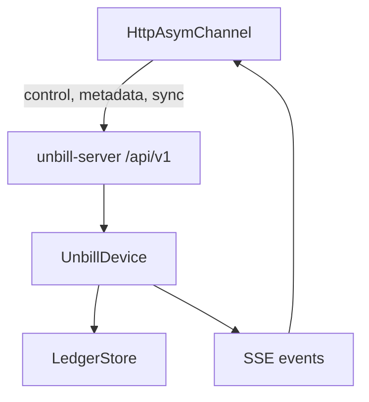

The HTTP API is authenticated with `Authorization: Bearer <account_session>`.
The server mounts the protected API under `/api/v1`.
`POST /accounts/register` and `POST /accounts/login` are public. Login returns
`{"token":"...","account_name":"..."}`. The protected account routes are
`GET /accounts`, `GET /accounts/me`, `POST /accounts/logout`, and
`PUT /accounts/password`. Password changes revoke all sessions. Registration
does not grant access to existing ledgers.

Ledger endpoints list ledgers,
write ledger metadata,
exchange binary Automerge sync messages,
create invitations,
and join ledgers from invitation URLs.
`POST /ledgers/{id}/share` grants an existing local account access to a ledger.
All ledger routes derive the source account from the validated bearer session.
Clients cannot choose the source account through a query or JSON field.

Peer endpoints trigger one-shot sync to a known peer `NodeId`.

Device endpoints expose the current device ID and a process-local BLE snapshot;
device names are fields in ledger sync data.
No arbitrary-key endpoint or secret-key access is exposed.

The events endpoint streams server-sent events.
`LedgerUpdated` events are serialized as JSON data fields.
Other event fields are ignored by the HTTP client,
and clients reconnect after connection errors or clean close.

The route surface is:
`GET /ledgers`,
`PUT /ledgers/{id}/meta`,
`POST /ledgers/{id}/sync`,
`POST /ledgers/{id}/invitations`,
`POST /ledgers/{id}/share`,
`POST /ledgers/join`,
`POST /peers/{node_id}/sync`,
`GET /device/id`,
`GET /device/ble`,
`GET /build-info`,
and `GET /events`.
Account routes are `POST /accounts/register`, `POST /accounts/login`,
`GET /accounts`, `GET /accounts/me`, `POST /accounts/logout`, and
`PUT /accounts/password`.

`POST /ledgers/{id}/sync` is the data-plane endpoint.
The client sends Automerge sync message bytes.
The server receives them into its document,
generates a response message when available,
saves when the document changed,
and returns either response bytes or no content.

The server rejects unparseable sync bodies as bad requests for authorized ledgers.
It maps unauthorized tokens to unauthorized responses.
Valid sessions without a ledger grant receive forbidden responses.
The removed generic `/device/{key}` routes return `404`.
Other non-success statuses map to storage or channel errors on the client side.

`GET /ledgers` returns a JSON array of ledger metadata objects.
`PUT /ledgers/{id}/meta` accepts and returns ledger metadata as JSON.
`POST /ledgers/{id}/invitations` returns `201` with `{"url": "..."}`.
`POST /ledgers/join` requires `{"url": "...", "label": "..."}` and returns `204`.
The label is the joining device's shared ledger name, not an alias for the host.
`GET /device/id` returns the node ID as `text/plain`.
`GET /device/ble` returns a `BleSnapshot` as JSON, protected by the same bearer
authentication. It describes the server's radio, not the browser's radio.
SSE data fields carry `{"type": "LedgerUpdated", "ledger_id": "..."}`.

`GET /build-info` returns the server version and UTC build timestamp as JSON behind the same bearer authentication.

PUT /api/v1/ledgers/{id}/archive accepts {"archived": boolean} and sets the server device preference. It requires the normal bearer authorization and an account grant, returns 204 on success, 400 for invalid ledger IDs and 403 without a grant. Ledger metadata responses include archived. Normal metadata PUT and document sync do not overwrite the archive preference.

The authenticated events stream also emits {"type":"BleSnapshotChanged"} from the device BLE watch channel, including an initial notification for each SSE connection so reconnecting clients refresh current state.
