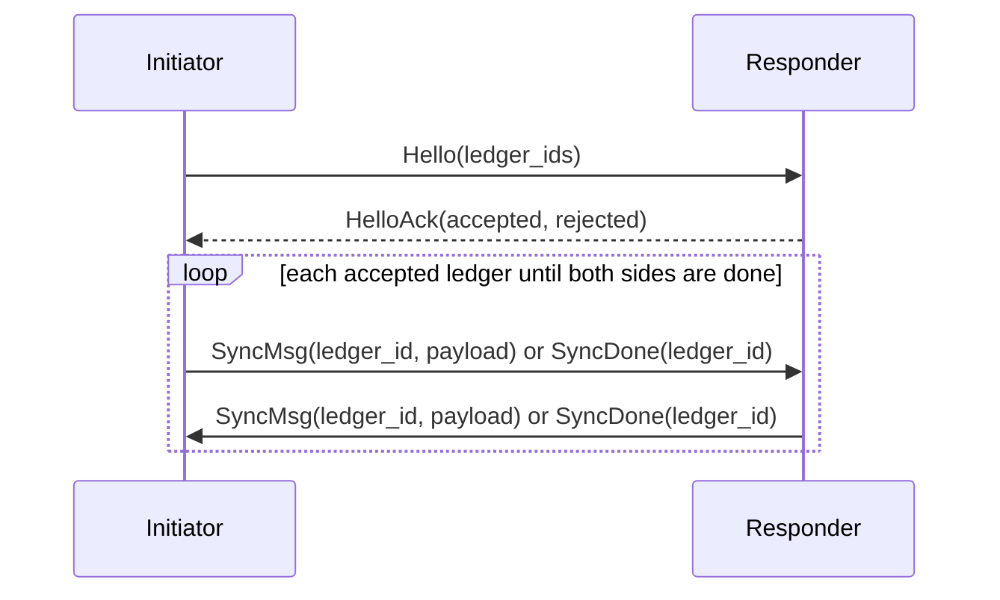
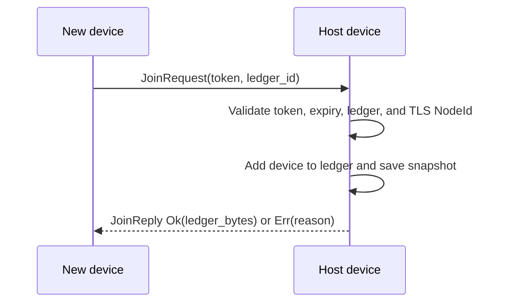

`unbill-symmetric-channel` is the peer-to-peer transport for devices.
All network I/O goes through Iroh.
Each device is identified by its `NodeId`.

The `unbill/sync/v1` protocol lets authorized peers exchange ledger lists
and Automerge sync messages.
The `unbill/join/v1` protocol lets an invite token authorize a new device,
append its `NodeId` to the ledger,
and return a full snapshot.

Discovery comes from known `NodeId` values in ledgers or invite URLs.
Authorization is ledger-scoped and based on TLS-authenticated `NodeId`.
Protocols use length-prefixed CBOR framing.
Sync state is session-local and is not persisted between connections.

`run_sync_session` returns changed ledger documents to the caller.
The caller is responsible for saving them through the store,
which emits `LedgerUpdated`.
The channel layer does not carry an event parameter.

Implementation layout:
`protocol.rs` owns ALPN constants, CBOR frame types, and framing helpers.
`sync.rs` owns the Automerge sync loop over abstract async streams.
`join.rs` owns host and requester join flows over abstract streams.
`endpoint.rs` wraps `iroh::Endpoint`,
binds with the device secret key,
and dispatches incoming connections by ALPN.
`node_id_ext.rs` converts between Unbill model types and Iroh types.

Protocol tests use in-process streams. A loopback endpoint regression test verifies
that an idle connection cannot block later connections across accept calls.
Coverage includes framing, convergence, authorization filtering,
and join success and failure paths.
Convergence tests also cover multiple shared ledgers with a one-sided user
restoration, and compare document fingerprints rather than only visible bills.
An Automerge message can require a response even after generation previously
returned no message; completion must account for all accepted ledgers.
Each ledger generates its initial message once, then only generates again after
receiving an Automerge message for that ledger. A message in flight is not
completion. Incoming messages reopen completion, and a session ends only when
both peers have sent Done for every ledger.

The join request includes a required typed name for the joining device. The host
adds it to the shared ledger device record. The requester persists the returned
snapshot without creating a local alias.

The responder accepts connections without waiting for earlier handshakes. Each
handshake and session runs in its own task, without an application-level
concurrent handshake limit.

The device service uses `accept_bi`, which keeps a JoinSet of incoming handshakes
and initial stream waits across calls. A stalled handshake or a connected peer
that never opens a stream cannot block later connections. Endpoint closure aborts
pending accept tasks.
The higher-level `accept_loop_inner` delegates acceptance to `accept_bi`, so both
entry points share one handshake and initial-stream implementation.

The initiator proposes only ledgers that authorize the TLS-authenticated remote
NodeId. Missing documents or authorization-read errors abort before sending Hello.
The responder's accepted IDs must be a subset of this authorized proposal; an
unproposed ID aborts before ledger sync data is sent. Protocol regression tests
verify that private IDs stay out of Hello and malicious acceptance is rejected.

Successful sync and join connections log their Iroh transport paths at INFO level,
on establishment, path changes, and closure. Each line includes a connection ID,
peer, protocol, direct/relay/ble/custom transport, remote address, selection and closure
flags, and available per-path QUIC byte counters (including protocol overhead).
These describe transport paths rather than proving mDNS address discovery. The
observer uses weak handles and does not keep connections alive for logging.

The endpoint uses Iroh 1.3 and the companion iroh-mdns-address-lookup service.
BLE is registered automatically on supported native platforms as described by
`ble-transport`, alongside the existing IP transports and lookup services.
LAN discovery advertises and resolves the _irohv1._udp Bonjour service. Shared
relays use Iroh's production hostnames; relay URLs remain available when dialing
by NodeId, alongside LAN lookup and the learned-address cache. A multicast
regression test connects using only a peer ID with relays disabled.
This test requires OS local-network permission and a multicast-capable interface;
on macOS it has been verified with an administrator-run test binary. Address
lookup failures close both endpoints before reporting the error.
Path logging consumes owned path events and transient weak-handle upgrades,
including final byte counters for closed paths, without retaining connections.

Sync completion must not immediately close QUIC while the peer may still be reading buffered frames. The initiator retains both stream halves, persists local changes, finishes its write side and waits for peer EOF before closing the connection. The receiver retains its writer until received changes are persisted, then finishes it to signal completion. EOF draining is bounded and rejects unexpected trailing bytes. Existing v1 framing is unchanged; older receivers already finish their writer on return, confirming protocol consumption but not necessarily persistence.
